# 实践课1：Pi Agent 安装与使用 lishengxi

这份记录涵盖我在 Windows 上配置 Pi Agent、接入 DeepSeek、测试代码和图片输入，以及使用插件和 PPT Skill 的过程。截图放在 [`01-Pi-Agent-start/`](./01-Pi-Agent-start/) 下，文件名按任务编号排列。

## 任务完成情况

| 序号 | 任务 | 完成情况 | 截图编号 | 任务书验收项 |
| --- | --- | --- | --- | --- |
| 1 | 安装并启动 Pi | 在 Windows PowerShell 中完成安装并启动 Pi | S1.1–S1.2 | S1 |
| 2 | 配置模型并完成会话 | 接入 DeepSeek API，使用 `deepseek-v4-pro` 完成对话 | S2.1–S2.3 | S2 |
| 3 | 切换模型和思考级别 | 切换 V4 Pro 和 Flash，测试 `off` 和 `high` | S3.1–S3.5 | S3 |
| 4A | 使用 `@` 引用代码 | 引用 `hello.py`，解释代码并确认输出为 `5` | S4.1-A | S4 |
| 4B | 测试图片输入 | 通过本地文件路径传入图片，Flash 识别出红苹果 | S4.2-B–S4.3-B | S5 |
| 5 | 安装并试用 Pi 插件 | 重启后加载 `pi-web-access`，查询长沙天气 | S5.1–S5.4 | S6 |
| 6 | 安装 PPT Skill | 将 `pptx` 安装到项目的 `.pi/skills/pptx` | S6.1–S6.3 | S7 |
| 7 | 启动发现与实际调用 | 重启后发现 `pptx`，调用 Skill 并生成两页 PPT | S7.1–S7.5 | S8 |

## 1. 安装并启动 Pi

在 Windows PowerShell 中完成安装，进入练习目录后运行 `pi`。

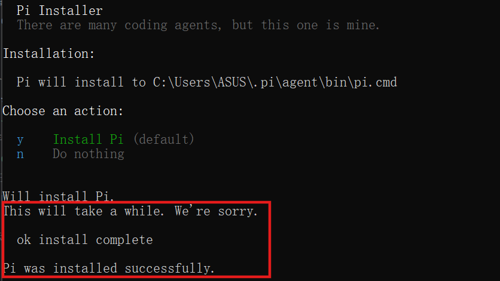

## 2. 接入 DeepSeek 并测试会话

在 Pi 中配置 DeepSeek API，选用 `deepseek-v4-pro`，用简单对话确认模型可以回复。

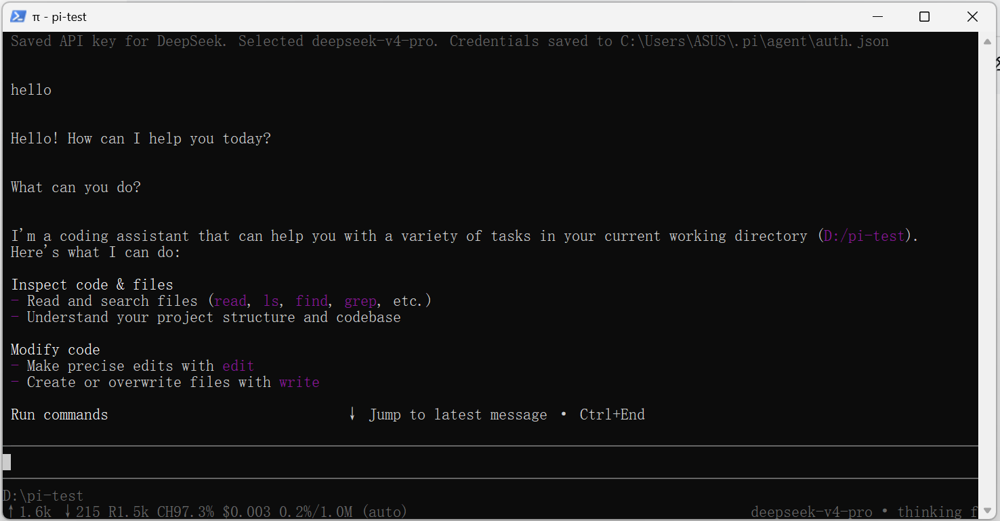

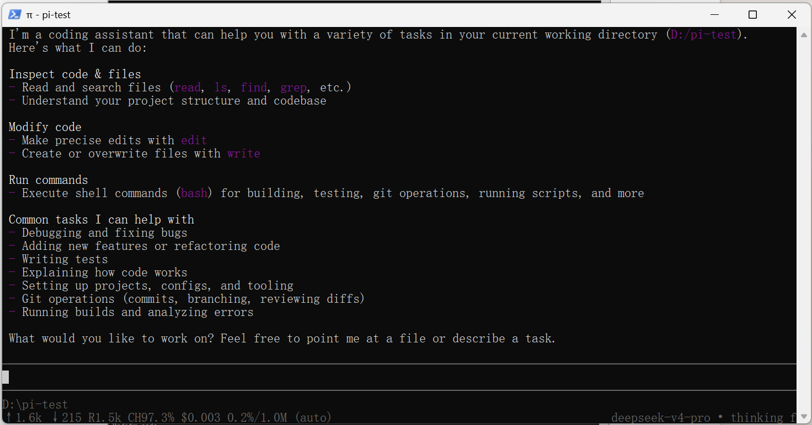

## 3. 切换模型和思考级别

用 `/model` 在 `deepseek-v4-pro` 和 `deepseek-flash` 之间切换，并测试 `off` 和 `high` 两种思考级别。

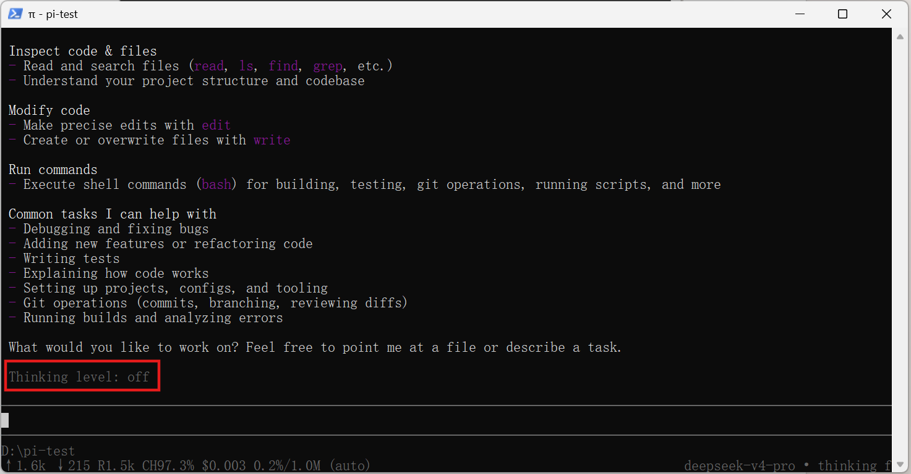

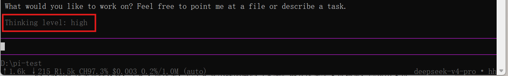

## 4. 引用代码和读取图片

### A 引用代码

用 `@hello.py` 引用代码，让 Pi 解释函数并确认运行结果为 `5`。

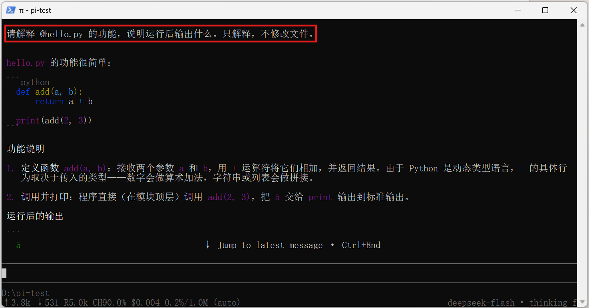

### B 读取图片

切到 `deepseek-flash` 后，在输入框提供图片的本地路径。Pi 读取文件后识别出图中是一颗红苹果。

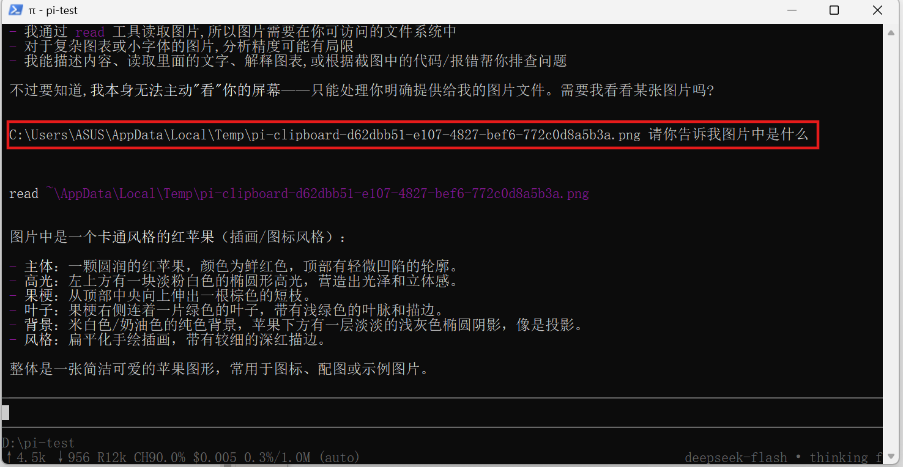

## 5. 安装并试用联网插件

运行 `pi install npm:pi-web-access`，重启后用插件查询长沙天气。

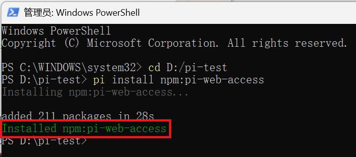

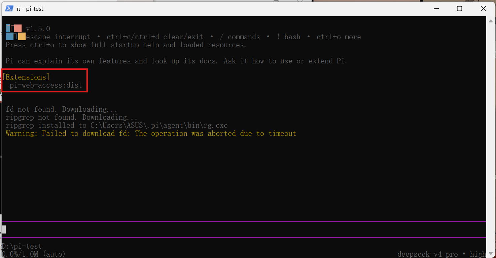

## 6. 安装 PPT Skill

让 Pi 将 `pptx` Skill 安装到项目的 `.pi/skills/pptx`，随后检查目录里的 `SKILL.md`、`LICENSE.txt` 和 `scripts`。

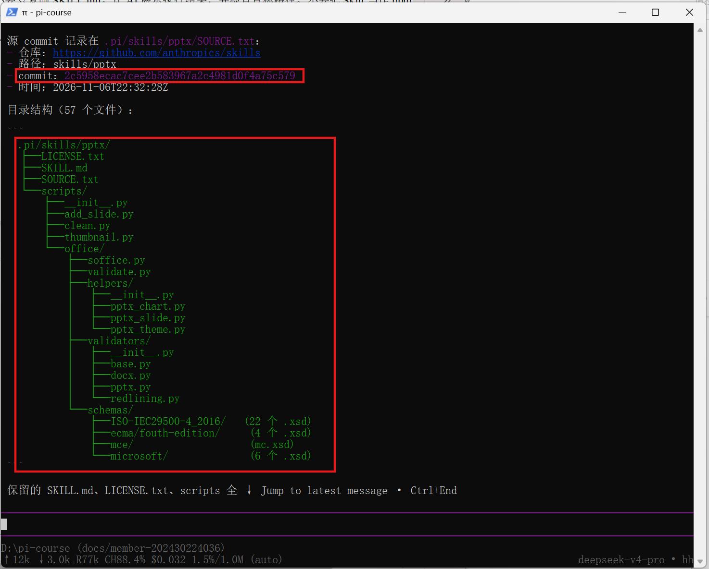

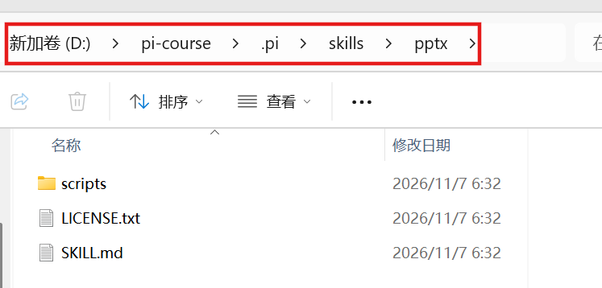

## 7. 加载并调用 PPT Skill

重启 Pi 确认已加载 `pptx`，用 `/skill:pptx` 查看用途，再生成并打开两页演示文稿。

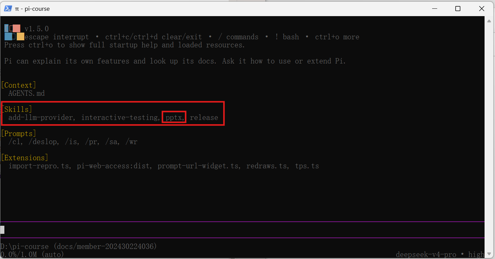

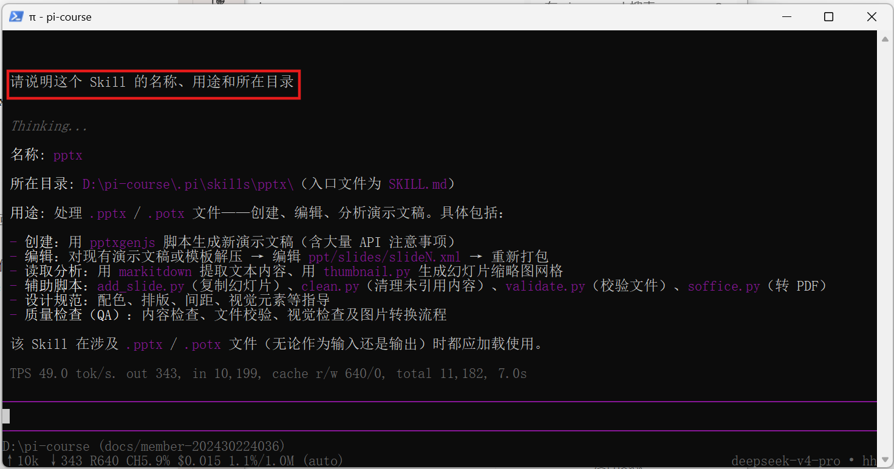

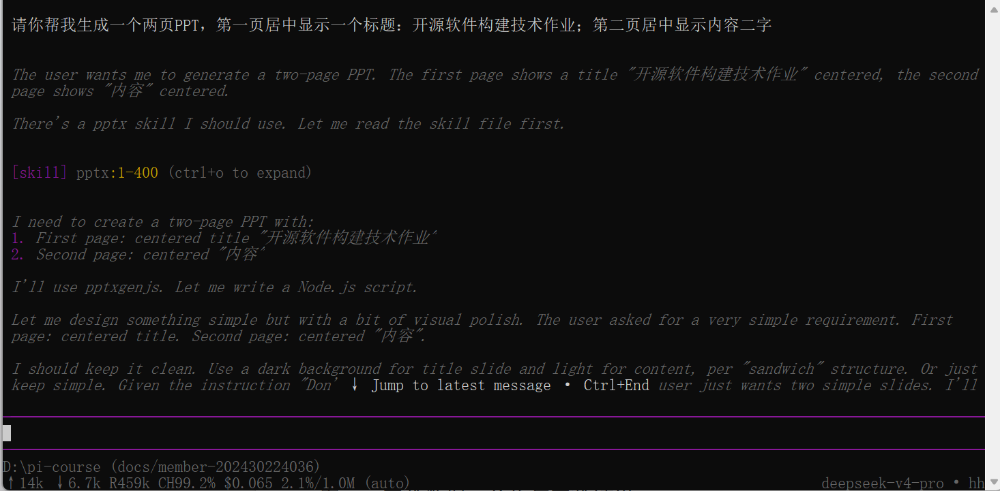

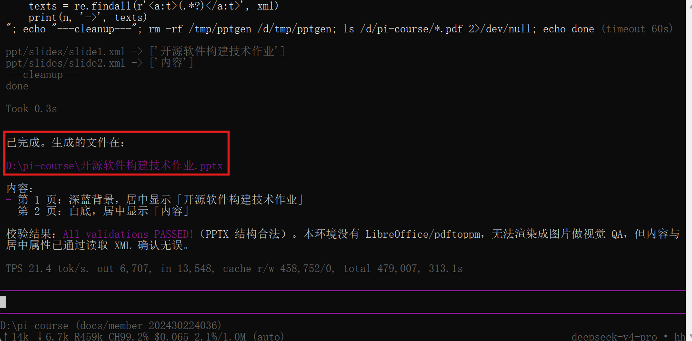

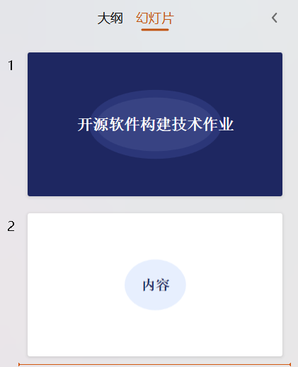

## 截图清单

| 截图 | 对应内容 |
| --- | --- |
| [S1.1.png](./01-Pi-Agent-start/S1.1.png) | PowerShell 中的 Pi 安装成功提示 |
| [S1.2.png](./01-Pi-Agent-start/S1.2.png) | 首次启动 Pi，进入练习目录下的终端界面 |
| [S2.1.png](./01-Pi-Agent-start/S2.1.png) | 配置 DeepSeek API 后发送问候和能力询问 |
| [S2.2.png](./01-Pi-Agent-start/S2.2.png) | V4 Pro 回复可执行的操作 |
| [S2.3.png](./01-Pi-Agent-start/S2.3.png) | 查看当前 DeepSeek 模型、提供方和思考级别 |
| [S3.1.png](./01-Pi-Agent-start/S3.1.png) | 打开模型选择器，查看 V4 Pro 和 Flash |
| [S3.2.png](./01-Pi-Agent-start/S3.2.png) | 状态栏显示当前模型为 `deepseek-v4-pro` |
| [S3.3.png](./01-Pi-Agent-start/S3.3.png) | 切换到 `deepseek-flash` 后的提示和状态栏 |
| [S3.4.png](./01-Pi-Agent-start/S3.4.png) | 将思考级别设为 `off` |
| [S3.5.png](./01-Pi-Agent-start/S3.5.png) | 将思考级别设为 `high` |
| [S4.1-A.png](./01-Pi-Agent-start/S4.1-A.png) | 用 `@hello.py` 引用代码，Pi 解释加法函数并显示输出 `5` |
| [S4.2-B.png](./01-Pi-Agent-start/S4.2-B.png) | 用于读图测试的红苹果原图 |
| [S4.3-B.png](./01-Pi-Agent-start/S4.3-B.png) | 通过本地路径读取图片，Flash 描述苹果、叶子和背景 |
| [S5.1.png](./01-Pi-Agent-start/S5.1.png) | PowerShell 显示 `pi-web-access` 安装成功 |
| [S5.2.png](./01-Pi-Agent-start/S5.2.png) | 重启后在 `[Extensions]` 中看到 `pi-web-access` |
| [S5.3.png](./01-Pi-Agent-start/S5.3.png) | 询问长沙天气后，Pi 调用搜索工具 |
| [S5.4.png](./01-Pi-Agent-start/S5.4.png) | 返回长沙天气和出行提示 |
| [S6.1.png](./01-Pi-Agent-start/S6.1.png) | 让 Pi 把 `pptx` Skill 安装到当前项目 |
| [S6.2.png](./01-Pi-Agent-start/S6.2.png) | 终端输出安装后的 `pptx` 目录结构 |
| [S6.3.png](./01-Pi-Agent-start/S6.3.png) | 在资源管理器中查看 `SKILL.md`、`LICENSE.txt` 和 `scripts` |
| [S7.1.png](./01-Pi-Agent-start/S7.1.png) | 重启 Pi 后在 `[Skills]` 中看到 `pptx` |
| [S7.2.png](./01-Pi-Agent-start/S7.2.png) | 调用 `/skill:pptx` 查看 Skill 用途和所在目录 |
| [S7.3.png](./01-Pi-Agent-start/S7.3.png) | 提交生成两页 PPT 的请求，Pi 读取 `pptx` Skill |
| [S7.4.png](./01-Pi-Agent-start/S7.4.png) | 终端显示生成的 PPTX 路径和文件结构验证结果 |
| [S7.5.png](./01-Pi-Agent-start/S7.5.png) | 打开生成的 PPT，显示标题页和内容页 |
