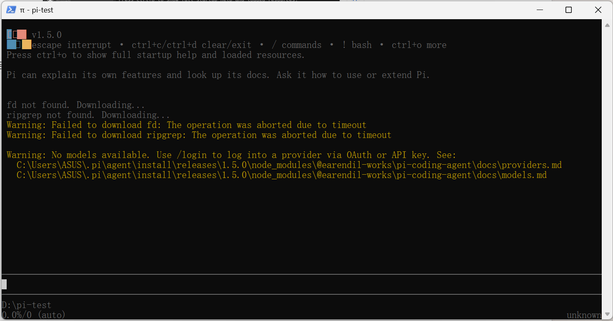
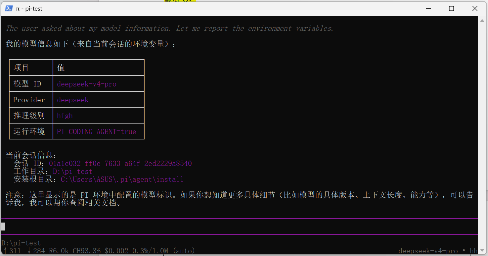
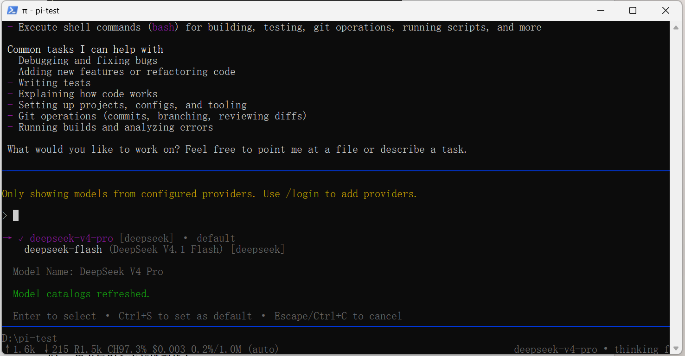
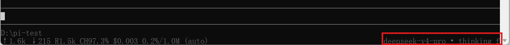
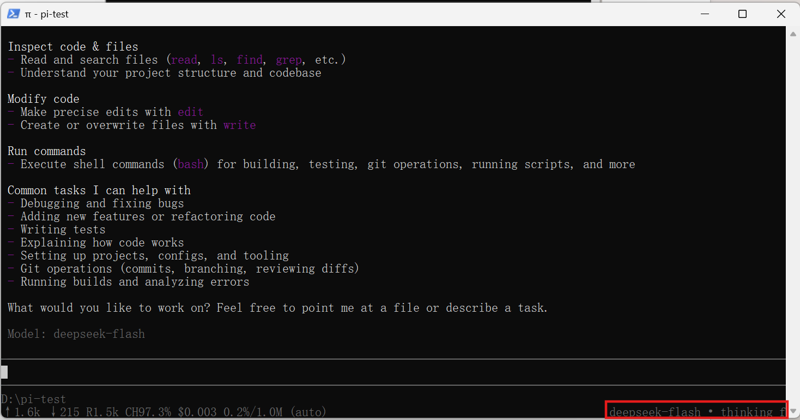
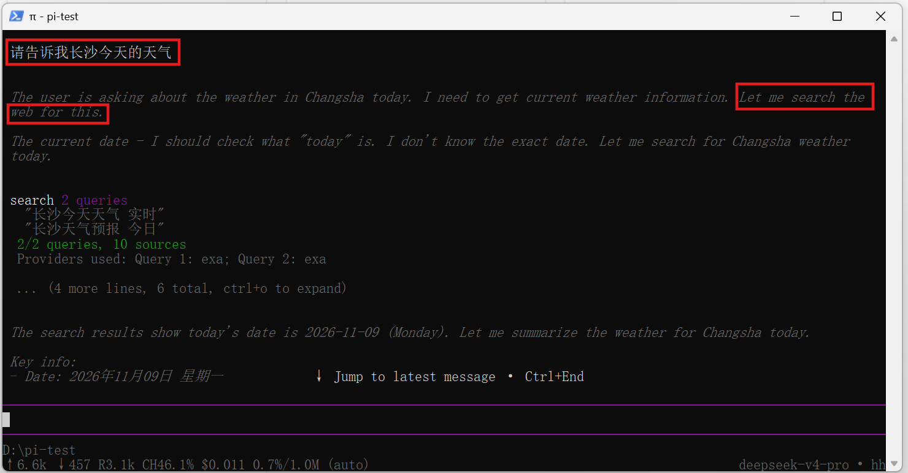
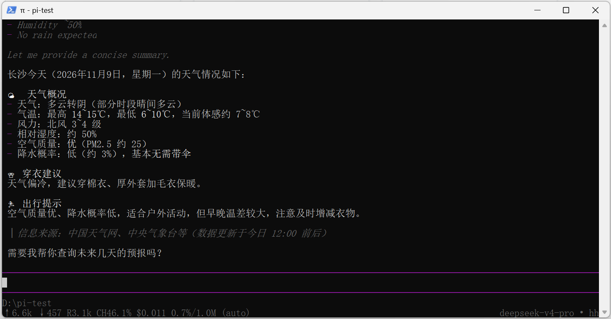
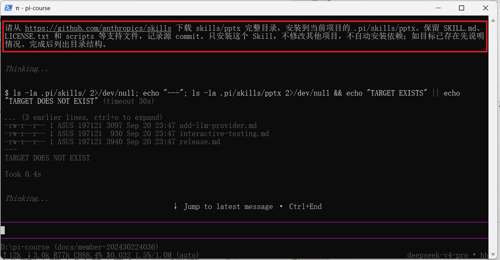

# Pi Agent安装与使用

## 任务一 本地安装并启动

截图S1：

在 PowerShell 安装成功截图：

启动pi-agent截图：

## 任务二 配置模型并完成一次会话

截图S2：

发出的提示词以及回复截图：

当前模型信息截图：

## 任务三 切换模型与模型思考级别

截图S3：

模型切换选择：

选择deepseek-v4-pro模型：

选择deepseek-flash模型：

选择思考水平off：

选择思考水平high：

## 任务四 引用代码并粘贴小图片

### A 使用 @ 引用代码文件

截图S4：

### B 粘贴小图片并测试

截图S5：

Pi-agent读取的图片：

## 任务五 安装并使用一个插件

截图S6：

安装成功输出：

重新运行 pi 后的加载信息：

插件调用查询天气：

## 任务六 让 AI 安装一个 PPT Skill

截图S7：

终端输出文件结构：

本地目录结构：

## 任务七 启动发现与实际调用

截图S8：

重新运行 pi 后的加载信息：

/skill:pptx 的调用及回复：

生成PPT的示例：

生成的PPT展示：

